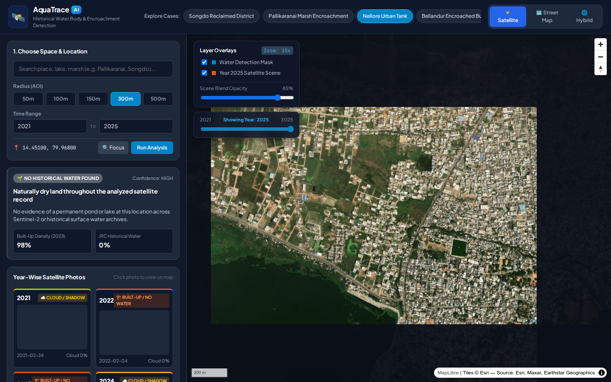
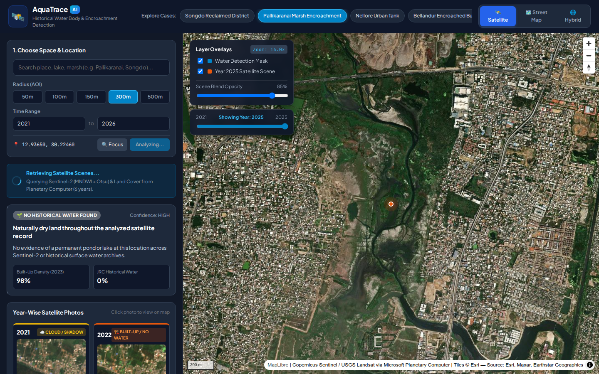
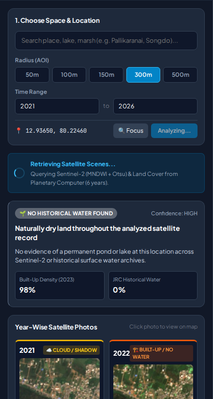
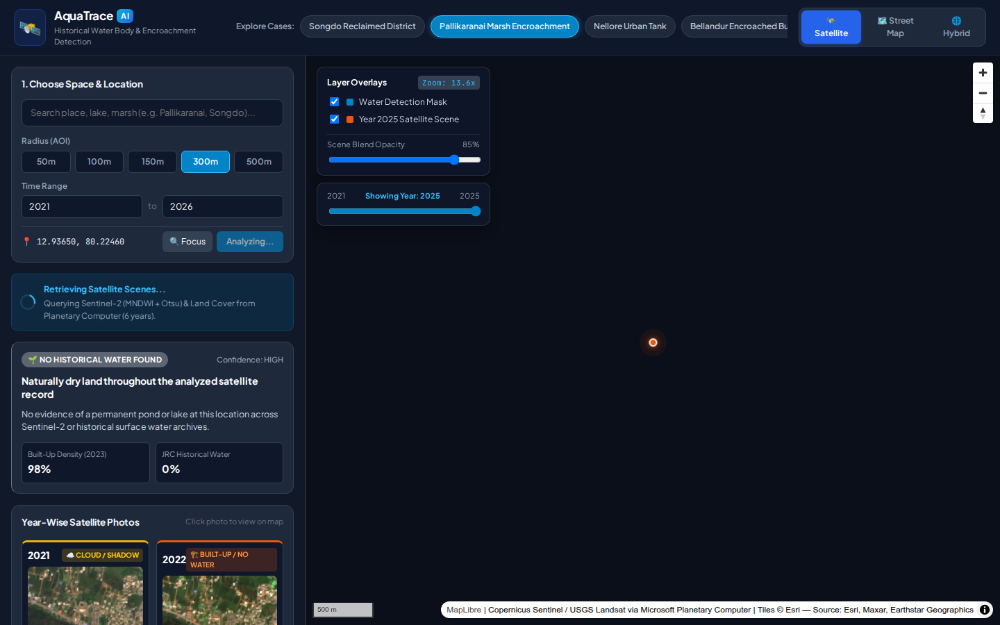

# 💧 AquaTrace — Historical Water Body & Encroachment Detection

> **Pick a point on a map. Get a year-by-year satellite verdict on whether a pond, lake, or wetland existed — and whether buildings replaced it.**

[](https://python.org)
[](https://fastapi.tiangolo.com)
[](https://vitejs.dev)
[](#data-sources)
[](#data-sources)

---

## 📸 Screenshots

### Main Application — Satellite Map + Analysis Panel



---

### Live Analysis — Pallikaranai Marsh Encroachment (Chennai)



---

### Control Panel — Location, Radius & Time Range



---

### Preset Case Selection — Explore Known Encroachments



---

## 🌊 What Is This?

Water bodies — ponds, lakes, wetlands, small reservoirs — disappear under construction with **no public record** of when or how much was lost. AquaTrace builds that record automatically from free public satellite archives.

**The verdict you get:**

```
2021: WATER DETECTED (MNDWI confidence: 96%)
2022: WATER DETECTED (MNDWI confidence: 97%)
2023: WATER DETECTED (MNDWI confidence: 94%)
2024: NO WATER — Built-up 88% density
2025: NO WATER — Built-up 88% density
2026: NO WATER — Built-up 88% density

🚨 BUILDING OVER WATER DETECTED
Water body existed through 2023, disappeared by 2024.
```

---

## 🎯 Who Is It For?

| User | Use Case |
|------|----------|
| 🗞️ Environmental journalists | Build a satellite-backed evidence trail for water-body loss stories |
| 🏘️ Residents & NGOs | Document encroachment of a specific local lake or pond dispute |
| 🗺️ Urban planners / GIS hobbyists | Explore land-cover change at any location on Earth |

---

## ✨ Key Features

- **Click anywhere on the map** → instant year-by-year water/no-water timeline (2013–2026)
- **Encroachment detection** — automatically classifies results into:
  - 🚨 `BUILDING OVER WATER DETECTED` (HIGH / MEDIUM confidence)
  - 💧 `ACTIVE WATER BODY PRESERVED`
  - 🏜️ `WATER DRIED / BARE GROUND`
  - 🌱 `NO HISTORICAL WATER FOUND`
- **Extended historical search** — falls back to Landsat (30 m, from 2013) when Sentinel-2 shows no water at all
- **Multi-layer satellite view** — toggle between ESRI Satellite, OpenStreetMap, and Hybrid
- **Year-wise satellite photo thumbnails** — see the actual scene for every year
- **Layer overlays** — Water Detection Mask + yearly satellite scene blend with opacity slider
- **Built-in preset cases** — Pallikaranai Marsh, Bellandur Lake, Nellore Tank, Songdo Korea
- **SQLite result cache** — repeat queries are instant
- **Zero accounts, zero API keys** — all data from Microsoft Planetary Computer's anonymous STAC endpoints

---

## 🏗️ Architecture

```
Browser (React + MapLibre GL)
        │
        │  GET /api/timeline?lat=&lon=&start_year=&end_year=&buffer_m=
        ▼
FastAPI Backend (Python 3.10+)
    ├── Concurrent ThreadPoolExecutor (max 3 workers to avoid PC 429s)
    ├── SQLite result cache (backend/cache.sqlite3)
    ├── SAS token warmup on startup (pre-mints all 4 containers in parallel)
    └── Sequential mop-up retry pass for any failed years
        │
        │  STAC search + SAS sign + raster pixel reads
        ▼
Microsoft Planetary Computer (anonymous / free)
    ├── Sentinel-2 L2A         — MNDWI water index (B03 Green + B11 SWIR), 10 m
    ├── JRC Global Surface Water — historical occurrence % (v1_3, ~2020 vintage)
    ├── IO Annual LULC v02     — built-up land cover classification
    └── Landsat C2 L2          — extended back-search from 2013 (30 m)
```

---

## 🚀 Run Locally

**Requirements:** Python 3.10+ · Node 20+

### 1. Backend

```bash
cd backend
python3 -m venv .venv
./.venv/bin/pip install -r requirements.txt
./.venv/bin/uvicorn app.main:app --port 8000
```

### 2. Frontend

In a second terminal:

```bash
cd frontend
npm install
npm run dev
```

Open **http://localhost:5173** — Vite proxies `/api` to the backend on port 8000.

---

## 🔌 API Reference

### `GET /api/timeline`

| Parameter | Type | Default | Description |
|-----------|------|---------|-------------|
| `lat` | float | required | Latitude (-90 to 90) |
| `lon` | float | required | Longitude (-180 to 180) |
| `start_year` | int | 2021 | Start year (2015–2026) |
| `end_year` | int | 2026 | End year (2015–2026, max 12yr range) |
| `buffer_m` | float | 150 | AOI half-width in meters (30–2000) |

**Response fields per year:**

| Field | Description |
|-------|-------------|
| `status` | `ok` · `point_obscured` · `no_clear_imagery` · `degenerate_scene` · `error` |
| `water_at_point` | `true` / `false` / `null` |
| `confidence_pct` | Heuristic distance from Otsu threshold (not a calibrated probability) |
| `scene_id` | Sentinel-2 scene identifier |
| `scene_date` | Actual acquisition date used |
| `cloud_cover_pct` | Scene-level cloud cover |
| `otsu_threshold` | Computed Otsu MNDWI threshold for the AOI |
| `water_mask` | WGS84 GeoJSON of AOI water pixels |
| `summary` | Plain-language narrative of the full timeline |
| `encroachment_analysis` | Structured verdict with badge, confidence, headline, details |

### `GET /api/presets`

Returns the 4 built-in case study locations with coordinates, year ranges, and descriptions.

### `GET /api/health`

Returns `{"status": "ok"}`.

---

## 📍 Built-in Case Studies

| Location | Tag | What happened |
|----------|-----|---------------|
| **Pallikaranai Marsh, Chennai** | Wetland Encroachment | Historic marshland shrunk and built over by urban infrastructure & IT corridor |
| **Bellandur Lake, Bengaluru** | Lake Buffer Construction | Catchment buffer encroached by tech parks & residential towers |
| **Nellore Urban Tank, Andhra Pradesh** | Urban Lake Encroachment | Urban water tank shrinking under expanding city construction |
| **Songdo, South Korea** | Lake / Basin Reclaimed | Tidal basin converted into urban commercial city |

---

## ⚠️ Things to Know

- **Resolution:** Per-year verdicts are for the clicked pixel (10 m Sentinel-2). Water bodies smaller than ~900 sq m may not be detected.
- **Rate limits:** Planetary Computer's anonymous endpoints return 429 under load. The backend caps concurrency at 3, retries with backoff, and runs a sequential mop-up pass. A 6-year query typically takes **30–120 s cold**, instant when cached.
- **Confidence:** `confidence_pct` is a heuristic distance from the Otsu threshold — not a calibrated probability.
- **Building label:** Uses a current-snapshot footprint dataset; it is not evidence a building existed in a specific year.
- **JRC GSW:** v1_3 (~2020 vintage) — occurrence figures do not reflect 2021+.
- **PNG export:** Uses the map canvas (`preserveDrawingBuffer: true`), captures only what is currently rendered.

---

## 📂 Project Structure

```
map-water-detection/
├── backend/
│   ├── app/
│   │   ├── main.py          # FastAPI app, timeline endpoint, encroachment analysis
│   │   ├── detection.py     # Sentinel-2 MNDWI + Otsu per-year analysis
│   │   ├── pc_client.py     # Planetary Computer STAC + SAS signing client
│   │   ├── cross_check.py   # JRC GSW occurrence + MS Building Footprints
│   │   ├── landsat.py       # Landsat C2 L2 extended back-search
│   │   └── cache.py         # SQLite result cache
│   └── requirements.txt
├── frontend/
│   ├── src/
│   │   ├── App.jsx          # Main React component (map, timeline, overlays)
│   │   └── App.css          # Dark-theme styles
│   └── index.html
└── docs/                    # Research log, architecture decisions, methodology
```

---

## 🗃️ Data Sources

All data is fetched **anonymously** from [Microsoft Planetary Computer](https://planetarycomputer.microsoft.com/) — no account or API key required.

| Dataset | Provider | Resolution | License |
|---------|----------|------------|---------|
| Sentinel-2 L2A | Copernicus / ESA | 10 m | Open |
| JRC Global Surface Water | EC JRC / Google (Pekel et al. 2016) | 30 m | Open |
| IO Annual LULC v02 | Impact Observatory / Esri | 10 m | Open |
| Landsat Collection 2 L2 | USGS | 30 m | Open |
| MS Global ML Building Footprints | Microsoft | — | CDLA-Permissive-2.0 |
| Basemap tiles | © OpenStreetMap contributors / ESRI | — | ODbL / Esri |

---

## 📄 Attribution

Copernicus Sentinel data · Source: EC JRC/Google (Pekel et al. 2016) · Microsoft Global ML Building Footprints (CDLA-Permissive-2.0) · © OpenStreetMap contributors · Served via Microsoft Planetary Computer.
